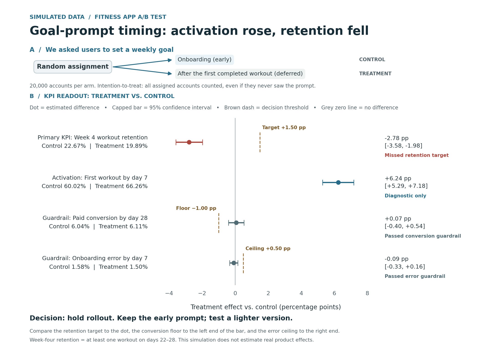

# Fitness goal timing experiment

**SYNTHETIC PORTFOLIO CASE STUDY | v1.4 | Aviv Emanuel**



Start with `outputs/decision_memo.pdf` and the figure above. The editable memo is `outputs/decision_memo.md`; `render.py` regenerates its PDF and chart from the same result object. `experiment.ipynb` contains the executed analysis and embedded figure.

## Product decision

Should a hypothetical fitness app move its optional weekly goal prompt from onboarding to immediately after the first completed workout? Control and treatment use the same wording and skip option. Prices, reminders and workouts stay fixed, and goals do not customize workout selection. The primary outcome is any workout during days 22-28, measured in every assigned account. First workout by day 7 is diagnostic. Paid conversion and onboarding errors are guardrails.

The main scenario deliberately assumes an activation-retention conflict. Its simulated decision is to retain the onboarding prompt and test a lighter prompt separately. No real product decision, deployment or retention effect is claimed. The supplied data contain only generated accounts.

## Reproduce offline

Use Python 3.10 or newer. Data generation, statistics, SQL cross-checks and the core validation require only Python's standard library. From this folder run

```sh
python analysis.py
python validate.py
```

To reproduce the PDF, PNG and editable memo, use an environment with Matplotlib and ReportLab installed, then run

```sh
python run_all.py
```

Every execution reads local files only. There are no API calls, credentials, remote datasets, telemetry or runtime downloads. `requirements.txt` records the validated versions. These third-party rendering dependencies must already be installed for a fully offline render; they are not bundled. The pre-rendered files work without Python. Numeric results and the CSV are deterministic; exact image/PDF bytes can differ across fonts or renderer versions.

Open `experiment.ipynb` in an existing Jupyter installation and Run All. The delivered notebook was schema-validated and all seven code cells executed successfully in a fresh in-process IPython shell. `python execute_notebook.py` reproduces that execution and the embedded chart without a Jupyter server or socket-based kernel. The notebook additionally needs IPython and a Python kernel. `requirements-validation.txt` records the tools used to execute and validate it. Dependencies can be provisioned before going offline. `validate.py` verifies core numeric reproducibility without a notebook installation or rendering dependencies.

## Files

- `protocol.json` freezes sample size, seed, assumed rates and decision thresholds before the first simulation. Its SHA-256 is recorded in results. The seed is 20261125, with no seed search or rerolls.
- `analysis.py` generates the account file, Wilson/Newcombe intervals and policy decisions.
- `metrics.sql` independently reconstructs all metric counts with SQLite.
- `data_dictionary.md` defines every column, denominator and modeling simplification.
- `render.py` creates the memo source, PDF and PNG from `outputs/results.json`.
- `validate.py` checks deterministic reruns, account and metric integrity, independent SQL counts and decision logic. With PyMuPDF installed, it also verifies PDF page count and result text.
- `run_all.py` builds and validates artifacts while blocking outbound network connections.
- `execute_notebook.py` executes and saves all notebook cells through a local IPython shell.
- `outputs/` includes the synthetic CSV, exact counts and estimates in CSV/JSON, memo PDF/Markdown, chart PNG and validation reports.
- `MANIFEST.sha256` records the checksum of every file in this folder, including the executed notebook.

## Version 1.3

The standalone figure shows the two arms as separate branches of random assignment before the results, explains the marks, and labels the decision thresholds and verdicts directly. The chart uses industry experimentation terms for the A/B test design, control and treatment, primary KPI, activation, guardrails and rollout decision. The analysis, assumptions, data and decision are unchanged.

## Version 1.4 (public edition)

Wording only: an employer-specific reference was removed from the README, memo, notebook and one protocol assumption, the labels now read as a public portfolio case study, and the PDF author is Aviv Emanuel. Files are now written as UTF-8 with LF line endings, so the editable memo keeps its typographic apostrophe and `python validate.py` passes on Windows as well as Linux and macOS; the code was reformatted for readability. The figure, data, counts, intervals and decisions are unchanged; only the protocol checksum differs because of the edited sentence.

## Decision contract and precision

The frozen worthwhile primary improvement is +1.50 percentage points. Rollout requires a point estimate at or above that target, a primary 95% lower bound above zero, a paid-conversion lower bound above -1.00 pp, and an error upper bound below +0.50 pp. Primary retention harm or clear guardrail harm overrides any benefit. Otherwise the decision is to retain current timing pending more evidence. This distinguishes demonstrated harm, failure to establish benefit, and a rollout recommendation.

The design uses 20,000 accounts in each arm with full follow-up and a single fixed-horizon readout. At the assumed 22.4% baseline retention, a conventional two-sided 5% test has roughly 95% power to detect a 1.5-point difference. This is a planning approximation, not the probability of satisfying the full rollout rule. Actual eligible traffic and recruitment time are unknown, so no real launch timetable is inferred. Enrollment would take 40,000 / eligible-new-accounts-per-day days, followed by up to 28 days of maturation.

The generator uses complete equal randomization, so 20,000/20,000 allocation is a design property, not an independent sample-ratio diagnostic. Validation checks persisted assignment and unique accounts. The analysis uses two-sided 95% Newcombe intervals built from independent Wilson intervals. The rollout rule requires all prespecified criteria to pass; the diagnostic cannot substitute for the primary endpoint. Sensitivity scenarios are descriptive alternatives using common random draws. None is selected after looking for a favorable result.

## Interpretation limits

Payment and errors are simplified independent Bernoulli outcomes. Early and late workouts are linked through explicit conditional probabilities. First-ever workouts on days 22-28 are omitted in this bounded model. Complete logging and stable account identity are assumed. A production study would validate these assumptions, define recruitment and eligible accounts with Product and Engineering, and assess concurrent experiments before launch. Comparing only exposed users or workout completers would condition on a post-assignment outcome and lose the randomized policy comparison.

## Portfolio framing

This exercise demonstrates the path from hypothesis to metric definition, instrumentation contracts, experimentation, conflicting signals and a product recommendation.

Aviv's [public retention case](https://www.avivemanuel.com/post/loyal-users-early-behaviors) reports a 23% improvement in retention prediction and stakeholder action on recommendations. That public claim is about predictive performance. This new exercise demonstrates a proposed causal experiment with simulated data. The source page provides context and supplies none of the generated records or assumptions.

AI assisted with protocol drafting, code, artifact production and checks. Reviewable code, frozen assumptions, exact counts, independent SQL aggregation and execution evidence accompany the outputs so the analyst can inspect every conclusion.
